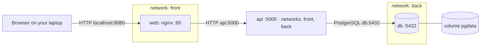

# Reference files used (Lab 2 fallback): yes
# Lab 4 · Multi-service app with Compose

GitHub user: ankitamandlik5-web · Reference files used (Lab 2 fallback): yes

<!-- Keep every heading as it is: the grader finds the sections by name. Fill in every blank (four underscores) and your GitHub user name: check.sh writeup flags anything left. -->

## 1 · Architecture



Which arrow crosses from your laptop into Docker: **browser → web on localhost:8080** — it is the only published port.

## 2 · Predictions and what happened

Part 1: fill in "I predicted" (the letter and a one-line reason) before you write any YAML. Part 3: fill in the rest. A wrong prediction that you explain earns full marks.

| # | I predicted | What I saw (command → the deciding output line) | Match? | If not: why |
|---|-------------|--------------------------------------------------|--------|-------------|
| P1 | b) nothing — `web` is on `front`, `db` is on `back`, no shared network, so Docker DNS won't resolve `db` | `docker compose exec web getent hosts db` → prints nothing (exit 2) | yes | |
| P2 | b) refused — `db` has no `ports:` mapping, so nothing is published on the laptop's 5432 | `nc -zv -w 3 localhost 5432` → `Connection refused` | yes | |
| P3 | a) still there — `docker compose down` keeps the named volume `pgdata` | `docker compose down` then `up -d --wait`, then `curl localhost:8080/api/todos` → the todo is still there | yes | |
| P4 | c) table is gone too — `down -v` deletes the volume, so the schema goes with the data | After `down -v`: `psql -c 'select count(*) from todos'` → `relation "todos" does not exist`; restore printed `CREATE TABLE` / `COPY 3`; final `curl` showed the todos | yes | |
| P5 | a) healthy · 500 — the health check tests the API process, not the DB; requests still fail while `db` is down | `stop db`: `ps api` → `Up (healthy)`, `curl` → `HTTP/1.1 500`; `up db`: `curl` → `HTTP/1.1 200`, same uptime | yes | |
| P6 | b) fail: name not found — `app.js` runs in the browser, outside any Docker network, so `api` doesn't resolve | `getent hosts api` from the laptop → `not found` | yes | |

## 3 · Backup and restore

```text
banknote@...$ mkdir -p backup
banknote@...$ docker compose exec -T db pg_dump -U todo -d todo > backup/todo.sql
banknote@...$ grep 'survive me' backup/todo.sql
4  ankitamandlik5-web: survive me  f  2026-10-19 19:00:56.303103+00
banknote@...$ docker compose down -v
[+] down 6/6
 ✔ Container course-app-web-1 Removed
 ✔ Container course-app-api-1 Removed
 ✔ Container course-app-db-1 Removed
 ✔ Volume course-app_pgdata Removed
 ✔ Network course-app_back Removed
 ✔ Network course-app_front Removed
banknote@...$ docker compose up -d --wait db
[+] up 3/3
 ✔ Volume course-app_pgdata Created
 ✔ Network course-app_back Created
 ✔ Container course-app-db-1 Healthy
banknote@...$ docker compose exec db psql -U todo -d todo -c 'select count(*) from todos'
ERROR:  relation "todos" does not exist
LINE 1: select count(*) from todos
                             ^
banknote@...$ docker compose exec -T db psql -U todo -d todo < backup/todo.sql
SET
SET
...
CREATE TABLE
ALTER TABLE
CREATE SEQUENCE
ALTER SEQUENCE
ALTER SEQUENCE
ALTER TABLE
COPY 3
...
ALTER TABLE
banknote@...$ docker compose up -d --wait
[+] up 4/4
 ✔ Container course-app-db-1 Healthy
 ✔ Network course-app_front Created
 ✔ Container course-app-api-1 Healthy
 ✔ Container course-app-web-1 Healthy
banknote@...$ curl -s localhost:8080/api/todos
[{"id":2,"title":"coding","created_at":"..."},{"id":3,"title":"ankitamandlik5-web: first","created_at":"..."},{"id":4,"title":"ankitamandlik5-web: survive me","created_at":"..."}]
```

Why the restore must run before `api` starts: `api/db.js` calls `ensureSchema()` at startup, which runs `CREATE TABLE IF NOT EXISTS todos (...)`. If `api` starts first, it creates the schema, and the dump's plain `CREATE TABLE` fails with `relation "todos" already exists`. Restoring first means the dump's schema exists, and `ensureSchema()` does nothing.
## 4 · Compose clinic

### c1 (worked example)
- Error line (copied): `connect ECONNREFUSED 127.0.0.1:5432`
- Checkpoint: port, inside `api`
- Fix: `DB_HOST: db`
- Why this fix, and not the tempting one: inside `api`, `localhost` is `api` itself, and nothing listens on 5432 there. Docker's DNS answers `db` with the database container's address. Publishing `db`'s port would "work" by opening a door into the database.
- Hints used: 0

### c2
- Committed fix: `lab4/clinic/c2/`
- Error line (copied): `curl -v localhost:8102` → `connect to 127.0.0.1 port 8102 failed: Connection refused`
- Checkpoint: port (reversed `HOST:CONTAINER` mapping)
- Fix: `web: ports: - "8102:3000"` (was `"3000:8102"`)
- Why this fix, and not the tempting one: format is `HOST:CONTAINER`; nginx listens on 3000 inside the container, and the mission's goal is to open on `8102` on the laptop. Tempting: change `nginx.conf` to listen on 8102 — but the mission says "nginx.conf stays as it is"; the fault is in the Compose mapping, not in the app.
- Hints used: 0

### c3
- Committed fix: `lab4/clinic/c3/`
- Error line (copied): `nginx: [emerg] host not found in upstream "api" in /etc/nginx/conf.d/default.conf:6`
- Checkpoint: name (Docker DNS on a shared network)
- Fix: `api: networks: [front, back]` (was `[back]`)
- Why this fix, and not the tempting one: `web` is on `front`, so it needs `api` on `front` too. Adding `web` to `back` would also fix the DNS, but it would give `web` access to `db`, and the goal explicitly requires "web still can't reach db". `api` on both networks keeps the boundary intact.
- Hints used: 0

### c4
- Committed fix: `lab4/clinic/c4/`
- Error line (copied): browser Console: `GET http://api:5000/api/todos net::ERR_NAME_NOT_RESOLVED`
- Checkpoint: path (browser can't resolve the name `api`)
- Fix: `public/app.js` line 2: `const API = '/api/todos';` (was `'http://api:5000/api/todos'`)
- Why this fix, and not the tempting one: `app.js` runs in the browser, outside any Docker network — it can't resolve `api`, and `localhost:5000` isn't published. Relative `/api/todos` goes to the same origin, and nginx forwards `/api/` to `api:5000`. Tempting: publish `api`'s port to the laptop — but that bypasses nginx and breaks the single-door pattern.
- Hints used: 0

### c5
- Committed fix: `lab4/clinic/c5/`
- Error line (copied): after `docker compose down` + `up -d`, `curl localhost:8105/api/todos` → `[]` (the todo is gone)
- Checkpoint: data (PostgreSQL writes to the container's writable layer)
- Fix: add `volumes: - pgdata:/var/lib/postgresql/data` under `db`, and a top-level `volumes: pgdata:`
- Why this fix, and not the tempting one: `down` deletes the container, and any data in the container layer goes with it. A named volume survives `down`/`up`. Tempting: use `docker compose stop` instead of `down` — that hides the bug but the mission tests `down`.
- Hints used: 0

## 5 · Run in one command

```bash
git clone https://github.com/ankitamandlik5-web/turiba-devops-labs.git && cd turiba-devops-labs
cp .env.example .env
docker compose up -d --wait
```

## 6 · Answers

### A1
`web` resolves `api` because both are on `front`. `web` does not resolve `db` because `db` is only on `back`, and Docker's DNS answers only for services on a shared network. `api` is on both, so it can reach both.

### A2
`api` talks to `db` inside Docker on the `back` network. The laptop could only reach `db` through a published port, and `db` has no `ports:`. In `docker compose ps`, `5432/tcp` without an arrow is `EXPOSE` only — nothing is published

### A3
`app.js` runs in the browser, outside Docker. `/api/todos` goes to the same origin (`localhost:8080`), and nginx in `web` forwards `/api/` to `api:5000`. The browser can't resolve the name `api` — only containers on the same network can.

### A4
`api/db.js` calls `ensureSchema()` at startup (`CREATE TABLE IF NOT EXISTS todos`). If `api` starts before the restore, it creates the schema, and the dump's plain `CREATE TABLE` fails with `relation "todos" already exists`. Restoring first means the dump's schema is in place and `ensureSchema()` does nothing.
